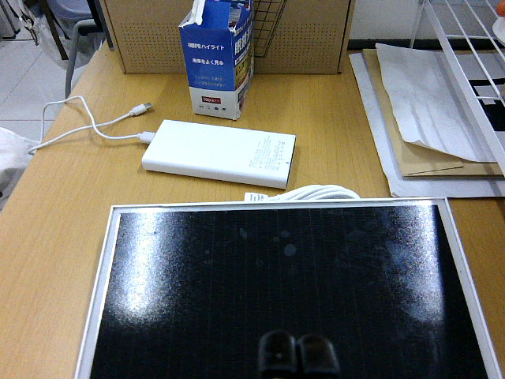

# 真实场景：板面出框反例

这是本项目摄像头于 2026-11-05 采集的真实彩色图，原尺寸 640×480，原始 PNG SHA-256 为 `9954d824a19224e54e2e941bb8f31e83d4d8a8ef519050b208c2b4faf3a2e0a7`。画面中板面下沿及右下角出框，夹爪遮挡底部，并有强反光。这里提供原色图用于讨论出框拒识，不包含逐像素标注或与本图配对的深度数据。

既有离线记录显示：一个固定的光伏实例模型在此帧漏掉板体，并在板上方白色物体附近输出三个候选；另有白框算法拒绝，但拒绝理由不等于识别出真实截断。本图已参与开发，不能作为独立留出测试，也不能据此估计准确率。

欢迎提出可复现的板体选择和完整性判断方法，并在不同实拍完整板、截断板、无板和遮挡场景上分别报告误接受及误拒绝。不要将像素候选或本图视为机械臂运动许可。数据使用条款尚未确定。
